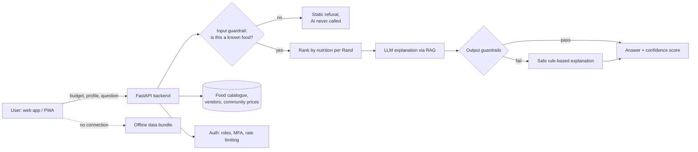

# 🥬 NutriMap AI

### Eat well on any budget. Find the most nutrition per Rand, and where to buy it.

🏆 **3rd Place, SMU Health Hackathon 2026** · hosted by **Geekulcha** at **Sefako Makgatho Health Sciences University (SMU)**

**[▶️ Watch the demo video](ADD-YOUR-DEMO-VIDEO-LINK-HERE)**

---

> ## 🔒 About this repository
> NutriMap AI is **currently in incubation**, so the source code is kept in a **private repository**. This public repository is a showcase: it explains what the product does, how it is built and how it is secured.
> **The code can be shown on request.** Recruiters, partners and reviewers are welcome to get in touch (see [Contact](#-contact)).

---

## 🏆 Recognition

NutriMap AI was built for the **SMU Health Hackathon 2026**, hosted by **Geekulcha**, and placed **3rd**. The hackathon's top three projects were earmarked for **implementation in the City of Tshwane**, and NutriMap AI is now going through **incubation** to take it from hackathon prototype toward a real-world product.

## 💡 The problem

For many households in Tshwane, the question is not "what is healthy?" but "what is the *most nutritious* food I can afford today, and where do I buy it?" Prices differ from one spaza, market or corner store to the next, and most nutrition tools ignore money entirely.

## ✅ The solution

You enter a budget. NutriMap AI **ranks foods by nutrition per Rand** (protein, iron and vitamin C for every R1 spent), shows you **where to buy them on a map**, and builds a **basket that fits your budget**. Every AI explanation is checked by a safety layer before you see it, and every recommendation carries a **confidence score**.

## ✨ Key features

| Feature | What it does |
|---|---|
| **Nutrition-per-Rand ranking** | Scores every food by protein, iron and vitamin C per Rand, so budget goes furthest. |
| **Vendor map** | 12 Tshwane vendor locations (markets, spazas, corner stores) with the cheapest vendor shown on each result and an embedded OpenStreetMap view. |
| **Vendors near me** | Browser geolocation ranks vendors by real distance. |
| **Community prices** | Vendors post prices on a vendor portal; those prices feed a public community price layer, with price-trend comparison by suburb. |
| **Smart basket** | Quantity controls, live budget tracking and **auto-fill within budget** using the best nutrition-per-Rand foods. |
| **Family coverage score** | Shows how much of a day's protein, iron, vitamin C and energy a basket covers for a household of N (0-100 balance score). |
| **Eating-for profiles** | General, Pregnancy, Young child, Diabetes-aware and Heart-health profiles re-rank results. General nutrition guidance only, never medical advice. |
| **Ask in plain language (RAG)** | Questions are answered using real catalogue rows, with an offline fallback. |
| **USDA verification** | Cross-checks nutrient values against USDA FoodData Central. |
| **Works offline** | Installable PWA; vendor data is bundled so the app keeps working with no connection. |

## 🧱 How it works

## 🛡️ Responsible AI

NutriMap AI does not give the language model free rein. Safety is built as **rule-based, auditable code**, not another unpredictable model.

**1. Input guardrail (before the AI is called).** The submitted item must match a real entry in the verified food dataset. Anything else is rejected with a static message and **no AI call is made**, which closes the door on prompt injection through the item name.

**2. Output guardrails (after the AI answers).**

| Check | Catches |
|---|---|
| Blocked phrase patterns | Medical claims, diagnoses, "cure", "guarantee" |
| Length bounds | Empty replies or the model rambling |
| Grounding check | The AI talking about the wrong food (hallucination) |
| Price mention | Explanations that don't reference the real price |

If any check fails, the response is **discarded automatically** and replaced with a deterministic, template-based explanation that always passes.

**3. Confidence scoring.** Every recommendation gets a 0-100 score with reasons: it starts at 100 and loses points for incomplete nutrient data, implausible prices or calories, and for a guardrail having to step in. It scores *how far to trust the system's answer*, not whether a food is healthy.

## 🔐 Security

Built with no extra dependencies for the auth layer, and aligned to the **OWASP Top 10**:

- **PBKDF2** password hashing
- **Signed, expiring session tokens**
- **Real TOTP two-factor authentication** (works with Google Authenticator and Authy)
- **Role-based access control** across three roles: **Shopper**, **Vendor / informal trader** and **Community Health Worker**
- **Login rate limiting** and enumeration-safe login
- **Security headers** on every response
- **Server-side checkout validation:** the browser sends only item names and quantities, and the server recalculates the total from verified data and never trusts a client-supplied price. Card details are never stored or sent to the backend (the payment step is a sandbox demo).

## 🧰 Tech stack

| Layer | Technology |
|---|---|
| Backend | Python, FastAPI |
| Frontend | JavaScript, HTML/CSS, installable PWA with offline support |
| AI | Retrieval-Augmented Generation (RAG) over the food catalogue, LLM via Groq with offline fallback |
| Data | Verified food dataset (CSV), vendor and price-history layer |
| Maps and verification | OpenStreetMap, browser geolocation, USDA FoodData Central |
| Security | PBKDF2, signed tokens, TOTP MFA, RBAC, rate limiting |

## 🔌 API at a glance

| Area | Endpoints |
|---|---|
| Recommendations | `/recommend`, `/profiles`, `/ask`, `/nutrition/lookup` |
| Vendors and prices | `/vendors`, `/vendors/near`, `/vendors/{id}`, `/vendors/{id}/prices`, `/foods/{name}/vendors`, `/foods/{name}/price-history`, `/price-map` |
| Community | `/vendor/prices`, `/community/prices` |
| Accounts | `/auth/register`, `/auth/login`, `/auth/mfa/setup`, `/auth/mfa/enable`, `/auth/mfa/verify`, `/auth/me` |
| Basket | `/checkout` |

## 🧭 Honest limitations and roadmap

- **Price data is simulated** (12 locations with 24 months of generated history) to demonstrate the data layer. Real community prices start flowing as vendors join.
- **Checkout is a sandbox.** It demonstrates the security pattern, with no real payment processor connected.
- **Storage is a flat file** today. Moving to **PostgreSQL** for concurrent vendor submissions is the planned next step.
- Next: onboard real vendors in Tshwane, integrate a live payment provider, and expand beyond the 12 pilot locations through incubation.

## 👥 Team

| | |
|---|---|
| **Benit Polvie Matumona** | Technical lead. Designed and built the whole platform: backend, frontend, AI pipeline, data layer and security. |
| **Mariam and Siwaphiwe** | Business side of the project. |

## 📬 Contact

Want to see the code, discuss the project or partner with us? Get in touch:

- 📧 polviedivine@gmail.com
- 💼 [linkedin.com/in/benit-polvie-matumona](https://linkedin.com/in/benit-polvie-matumona)
- 🐙 [github.com/benitmatumona](https://github.com/benitmatumona)

---

NutriMap AI provides general nutrition information only. It is not medical advice.

